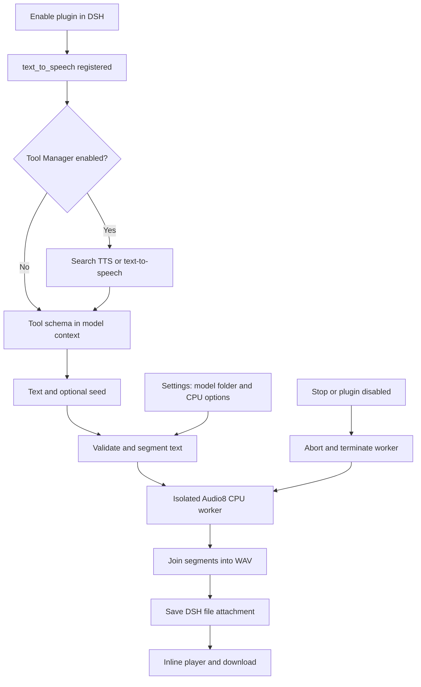

# DSH Text to Speech

A standalone DeepSeek Harness plugin that registers **`text_to_speech`** and returns a local WAV file with a native browser audio player and download link. Tool Manager can discover it by **TTS**, **text-to-speech**, **read aloud**, **narration**, or **voiceover**. Tool Manager is optional: without it the tool is available directly when the plugin is enabled.

This initial version uses **Audio8 0.1B ONNX INT8 on the CPU**. It does not load CUDA, claim a GPU lease, switch the chat model or depend on image/video plugins. The worker exits after each call to release model memory. GPU execution is not implemented or qualified in this release.

## Install

Requires DeepSeek Harness `0.2.1-rc.2`, Node 22.19+, Git, Linux and Python 3.11/3.12 with venv support. Linux is the qualified platform; other platforms have not been tested.

```sh
dsh plugin --profile web add github:averyjohnkucan-arch/dsh-tts
```

Install the isolated CPU runtime and pinned model files from the plugin checkout:

```sh
git clone https://github.com/averyjohnkucan-arch/dsh-tts.git
cd dsh-tts
python3 scripts/setup.py --python python3.12
```

Alternatively install a local checkout with `dsh plugin --profile web add link:/absolute/path/dsh-tts`. The Python environment and model are stored under `$DSH_HOME/dsh-tts`, defaulting to `~/.dsh/dsh-tts`. Use `--data-dir` for another location and set the plugin's `dataDir` configuration to match. Setup downloads approximately 423 MiB of model files, excluding Python packages and source. It keeps the default bundled reference voice locally; it does not upload a recording. No API key is required.

Start/restart DSH at a suitable time to load the installed bundle, then enable **dsh-tts** in Plugins. Installing this plugin does not itself restart DSH or start any model. Existing active sessions may need a new turn before discovery refreshes.

## Settings

Open **Settings → Text to Speech**. The page uses DSH's public `settings.section` slot and the plugin's authenticated settings API.

- **Model folder**: browse directories on the DSH host or enter an absolute path. Choose the entire Audio8 0.1B ONNX INT8 folder containing `runtime_manifest.json`, tokenizer, Slow AR, Fast AR and codec files. An individual model file is insufficient. PyTorch checkpoints and Audio8 0.6B exports are incompatible with this runtime.
- **CPU threads**: 1–4, default 1. Workers run at lower CPU priority on Linux.
- **Seed**: default 42, overridable per tool call.
- **Segment pause**: 0–1000 milliseconds, default 180.
- **Advanced**: temperature, top P, top K, Python executable, Audio8 runtime folder and default voice-profile folder.

**Validate files and save** checks the manifest, component paths and default voice compatibility, then atomically persists settings to `runtime.json`. This checks installation files without loading the model. It does not claim inference has passed. Changes affect subsequent calls. Changing runtime settings while synthesis is running is rejected.

The Plugins checkbox controls registration and disposal. Disabling the plugin cancels its workers. No global registry patch, DSH core modification or dependency on another third-party plugin is needed.

## Tool

```json
{"text":"Hello. This speech was generated locally.","seed":42}
```

Only `text` is required. Speak the user's requested words; do not silently embellish a script. Text is limited to 12,000 Unicode characters per call and split into segments of at most 150 characters, preferring sentence and word boundaries. Each segment uses the same default reference voice; segments are joined into one 16-bit PCM WAV. Progress reports completed segments, not a fabricated token percentage or ETA. Longer scripts may take substantial CPU time. One call runs at a time to bound memory.

The result includes a durable DSH file attachment, workspace-relative saved path, duration, sample rate and segment count. Generated audio is saved inside the active chat workspace at `dsh-audio/tts-<job-id>/generated-speech.wav`; a chat without a workspace fails clearly instead of falling back to a private runtime folder. DSH also keeps its normal content-addressed attachment copy so chat history remains playable. Audio appears beneath the tool call and at the turn tail even when the process group is collapsed. Playback supports browser seeking and download through an owner-authorized route. No autoplay is forced.

**Stop** aborts the tool signal and terminates its worker; a cancelled call does not publish a completed attachment. It may leave an empty job directory. Already completed files are retained. The tool has a one-hour deadline. A worker that reaches its generation cap fails rather than silently publishing a capped segment.

## Expression tags and scope

**Audio8's inspected upstream documentation and runtime do not define supported emotion, cough, yawn, laugh or SSML control tags.** The model sees this limitation in the tool description and parameter help. Common invented tags are rejected instead of being presented as working controls. Ordinary punctuation can affect phrasing, but exact emotion or voice inflection is not guaranteed. Sampling settings are not emotion controls.

This release provides TTS only. It does not expose voice cloning, voice registration, speech-to-text, audio editing, multiple speakers, timed video dubbing or mixing. Audio8 upstream has voice-cloning capabilities; those are not surfaced by this plugin's initial tool.

## Architecture



Uses `defineTool`/`ctx.tools.register`, `ctx.effect` cleanup, `connection.authorizeIndex`, `webServer.register`, `webserver/index-inject`, public client slots and session chat bindings. Settings operations require an owner capability and matching origin. Model and runtime paths are configurable only through the owner settings interface, not model-supplied tool arguments. No synthesis is exposed through the settings endpoint.

## Tests and passing criteria

```sh
npm test
npm run check
# After CPU setup, include the real process-cancellation test:
TTS_TEST_PYTHON="$HOME/.dsh/dsh-tts/venv/bin/python" npm test
npm run smoke
```

Tests cover Unicode-preserving chunking, bounds and unsupported markup, settings validation/persistence, owner authorization and origin checks, single-tool registration, cancellation/concurrency, saved audio cards outside collapsed tool results, seeking, HEAD and download responses. Tests requiring the CPU environment explicitly skip when it is absent.

Local qualification also checks public Cordis/DSH tool registration with and without Tool Manager, keyword discovery, selection and removal on disable. A real short clip and a multi-segment clip must generate valid nonempty WAV files. Audio analysis must report finite samples, plausible duration and no clipping; CPU transcription is compared with the supplied text. This is a smoke qualification, not an exhaustive quality guarantee across languages and arbitrary scripts. See `VALIDATION.md` for the recorded run and deferred checks.

## Upstream and licenses

Audio8 source: [Edge0-AI/Audio8_TTS](https://github.com/Edge0-AI/Audio8_TTS), pinned to `07e40f5d0b03fc473635ef378654bfb581027ac3`.

Model: [Audio8/audio8-TTS-0.1B-ONNX-INT8](https://huggingface.co/Audio8/audio8-TTS-0.1B-ONNX-INT8), revision `317c12d4e0da83847b594fcf8bd74bf2c76615ec`.

Audio8 code and model are Apache-2.0 per upstream. This plugin is MIT. Downloaded upstream source retains its LICENSE and NOTICE. Model files, environments, generated speech, private settings and credentials are not included in the plugin repository.
